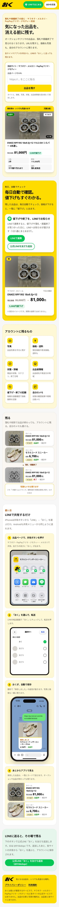
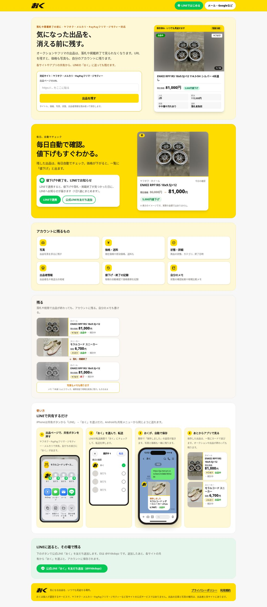

# おく

**公開URL: https://oku-bice.vercel.app/**

気になった出品を、落札や掲載終了で消える前に自分のアカウントへ残すメモアプリです。ヤフオク・メルカリ・PayPayフリマ・ジモティーに対応しています。出品ページのURLを貼るか、各サイトの共有からLINEの「おく」に送るだけで、その時点の価格・写真・状態・送料・出品者情報が残ります。保存した出品は毎朝自動でチェックし、値下げや終了をLINEでお知らせします。

カーセンサーなど中古車向けの姉妹アプリ「のこす」と、同じ作り・同じ使い心地にそろえています。

| スマホ（幅390px） | パソコン（幅1440px） |
| --- | --- |
|  |  |

各サイトの公式サービスではありません。出品の文章と写真の権利は、出品者と各サイトにあります。保存するのは、自分で開いた・LINEで送った **1件ずつの出品URL** だけです（一括収集はしません）。

## できること

- **URLから保存**: トップの入力欄にURLを貼ると、タイトル・価格（現在価格／即決）・入札数・送料・状態・カテゴリ・終了日時・出品者・発送元・説明文・写真を読み取って保存
- **LINEから保存**: 公式LINE「おく」を友だち追加し、各サイトやアプリの「共有」→ LINE →「おく」で送るだけ。返信のカードに保存結果が届く
- **写真**: 出品写真を保存先（Cloudflare R2）にコピーするので、出品が消えても見られる。残す写真はあとから選べる
- **価格の記録**: 毎朝7時（日本時間）に保存した出品を自動確認し、価格の推移と終了を記録。値下げは一覧に「値下げ」と表示
- **LINEでお知らせ**: 値下げ・落札・掲載終了を、1日1通にまとめてLINEへ
- **メモ・検討状況・比較**: 自分のメモと状態を残し、2〜3件を同じ項目で並べて比較（`/compare`）
- **共有ページ**: 選んだ写真と本文で共有ページ（`/s/…`）を作り、Xや端末の共有メニューへ。メモと出品者名は載せない
- **ログイン**: LINE（直接のLINEログイン）、X・Google・メール（Clerk）。どの端末でも同じ一覧が見られる

## 使っている技術

- Next.js 16（App Router・Turbopack）+ React 19 + TypeScript + Tailwind CSS v4
- Clerk（X / Google / メールのログイン）と、自前のLINEログイン（OAuth）
- Vercel（ホスティング・東京リージョン・毎朝のCron）
- Cloudflare R2（出品の記録と写真の保存先）、Cloudflare Browser Rendering（メルカリのページ読み取り）
- LINE Messaging API（公式アカウント「おく」での保存と通知）
- 読み取り: ヤフオク・PayPayフリマ・ジモティーはページの `__NEXT_DATA__`、メルカリは JSON-LD（取れないときは OGP）（`lib/sources/`）

## 手元で動かす

```bash
cp .env.example .env.local   # 必要なところだけ埋める
npm install
npm run dev                  # http://localhost:3000
```

```bash
npm test          # URLの判定・読み取りのテスト
npm run lint
npm run build     # 本番ビルド
```

環境変数が空でも、URLを貼っての保存は動きます。そのときデータは `./.data/` に JSON で保存されます（`OKU_DATA_DIR` で変更可）。

## 環境変数

値は Vercel の Environment Variables と `.env.local` に入れます。リポジトリには入れません。

| 変数 | 用途 |
| --- | --- |
| `NEXT_PUBLIC_CLERK_PUBLISHABLE_KEY` / `CLERK_SECRET_KEY` | Clerk（X・Google・メールのログイン）。両方そろうとログインが有効になる |
| `LINE_LOGIN_CHANNEL_ID` / `LINE_LOGIN_CHANNEL_SECRET` | LINEログイン（`LINE_LOGIN_REDIRECT_URI` で戻り先を変更可） |
| `LINE_CHANNEL_SECRET` / `LINE_CHANNEL_ACCESS_TOKEN` | LINE公式アカウント（Webhook `/api/line` の署名検証と返信・通知） |
| `R2_ACCOUNT_ID` / `R2_BUCKET` / `R2_ACCESS_KEY_ID` / `R2_SECRET_ACCESS_KEY` | Cloudflare R2。4つそろうと記録と写真を R2 に保存（未設定なら `./.data`） |
| `CF_ACCOUNT_ID` / `CF_BROWSER_TOKEN` | Cloudflare Browser Rendering（メルカリの詳しい読み取り。未設定なら簡易モード） |
| `AUTH_SECRET` | セッションと写真URLの署名（未設定なら `CLERK_SECRET_KEY` を使う） |
| `CRON_SECRET` | 毎朝の自動確認（`/api/cron/check`）の呼び出し確認 |
| `YAHOO_LOGIN_CLIENT_ID` / `YAHOO_LOGIN_CLIENT_SECRET` | 任意。Yahoo! JAPAN IDログイン。設定すると本番のログイン画面に「Yahoo!で続ける」が出る |

## LINE連携の設定

1. [LINE Developers](https://developers.line.biz/) で Messaging API チャネルを作る
2. Webhook URL を `https://<ドメイン>/api/line` にする
3. `LINE_CHANNEL_SECRET` と `LINE_CHANNEL_ACCESS_TOKEN` を設定する
4. 各サイトの出品画面で「共有」→ LINE → 公式アカウント「おく」へ送る

## フォルダの目安

- `app/` 画面とAPI（`/listings/[id]` 詳細、`/compare` 比較、`/s/[sid]` 共有ページ、`/api/line` LINE Webhook、`/api/cron/check` 毎朝の確認）
- `components/` 画面の部品（トップの見本や使い方の4コマもここ）
- `lib/sources/` サイトごとの読み取り、`lib/store.ts` 保存、`lib/notify.ts` LINE通知
- `tests/` URLの判定と読み取りのテスト
